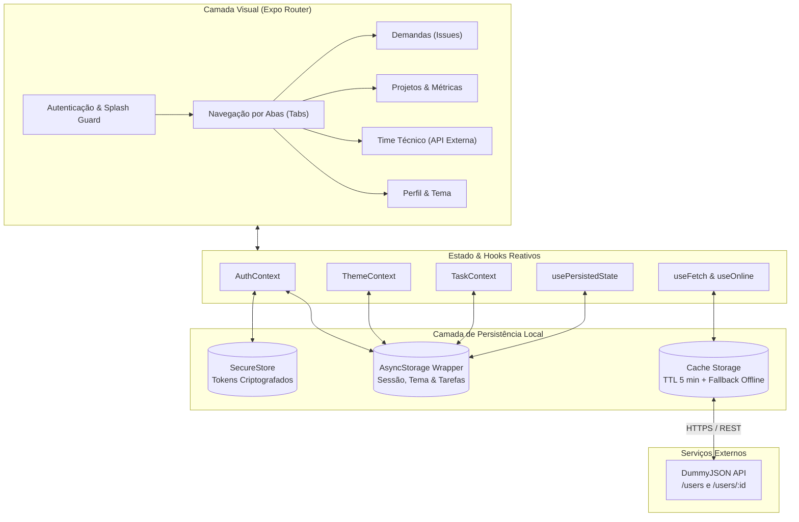

# StudyFlow - HP DevFlow

> **Hub mobile para gestão ágil de demandas e acompanhamento técnico de equipes de engenharia.**  
> Projeto prático desenvolvido para a disciplina de **Aplicativos Híbridos — Univassouras**.

---

## Sobre o Projeto

O **StudyFlow (HP DevFlow)** é um aplicativo mobile multiplataforma (iOS, Android e Web) construído com **React Native** e **Expo (SDK 57)**. Inspirado no ecossistema de ferramentas como GitLab e Jira, o app resolve a necessidade de acompanhamento ágil de issues, ciclo de entrega de software (Backlog -> Dev -> Revisão -> Concluído) e alocação de desenvolvedores.

O app combina dados de catálogo de membros vindos da API REST pública gratuita **DummyJSON** com um motor local de persistência, cache com tolerância a falhas e tematização dinâmica, assegurando que o desenvolvedor continue produtivo mesmo em ambientes de baixa ou nenhuma conectividade.

---

## Stack Tecnológica

- **Core:** React 19, React Native 0.86, TypeScript 6
- **Framework & Roteamento:** Expo SDK 57, Expo Router (navegação declarativa e baseada em arquivos)
- **Persistência Segura:** `expo-secure-store` (Criptografia Keychain/Keystore)
- **Persistência de Dados:** `@react-native-async-storage/async-storage` com Generics tipados
- **Conectividade:** `@react-native-community/netinfo`
- **Iconografia:** `lucide-react-native`
- **Interface & Layout:** `react-native-safe-area-context` e design tokens proprietários
- **Qualidade de Código:** Suíte própria de testes automatizados (`node --test`), TypeScript Compiler (`tsc`) e ESLint

---

## Guia Rápido de Inicialização

### Passo a Passo

```bash
# 1. Clone o repositório e acesse a pasta
cd StudyFlow/StudyFlow

# 2. Instale os pacotes necessários
npm install

# 3. Inicie o servidor de desenvolvimento Expo
npx expo start
```

### Como Visualizar o App
- **No Celular Físico:** Abra o aplicativo **Expo Go** e escaneie o QR Code exibido no terminal. Caso esteja em redes Wi-Fi públicas ou com isolamento de clientes, inicie com `npx expo start --tunnel`.
- **No Emulador Android:** Pressione a tecla `a`.
- **No Simulador iOS:** Pressione a tecla `i`.
- **No Navegador Web:** Pressione a tecla `w` ou execute `npx expo start --web`.

### Acesso de Demonstração
A tela de login conta com validação de formato e aceita qualquer e-mail com domínio corporativo ou pessoal para testes:
- **E-mail sugerido:** `gabriel.silva@hp.dev`
- **Senha:** `123456`

---

## Suíte de Testes Automatizados

Para certificar todos os fluxos críticos de negócio, persistência e resiliência offline, o projeto conta com uma suíte de testes de integração executável diretamente via Node:

```bash
# Executa os 15 testes de integração automatizados
npm test

# Valida tipagens estáticas em todo o projeto
npx tsc --noEmit

# Analisa boas práticas e regras de linter
npx eslint .
```

---

## Fluxo e Engenharia da Solução



---

## Domínios Funcionais e Mapeamento de Telas

Em vez de menus estáticos, o StudyFlow organiza a experiência do desenvolvedor em cinco domínios principais:

### 1. Autenticação, Proteção e Inicialização
- **`src/app/_layout.tsx` (Guarda Central):** Segura a Splash Screen nativa via `SplashScreen.preventAutoHideAsync()` até que tema e sessão sejam carregados simultaneamente do disco. Redireciona usuários sem sessão ativa para `/login` e bloqueia o retorno ao login se já autenticado.
- **`src/app/login.tsx` (`/login`):** Tela de login com validações de regex, controle de foco, teclado com scroll adaptativo (`KeyboardAvoidingView`) e área de toque acessível.

### 2. Time Técnico & Consumo de API Externa
- **`src/app/(tabs)/index.tsx` (`/(tabs)`):** Lista da equipe técnica consumida da API com 4 estados bem definidos (Carregando, Erro com retry, Lista Vazia e Sucesso), suporte a pull-to-refresh e banner de aviso quando desconectado.
- **`src/app/(app)/user/[id].tsx` (`/user/[id]`):** Detalhamento do membro da equipe técnica (nome, e-mail e cidade), com suporte a cache local prévio em caso de consulta offline.

### 3. Gestão de Demandas (Issues) & Ciclo de Vida
- **`src/app/(tabs)/tasks.tsx` (`/(tabs)/tasks`):** Listagem de issues com filtros segmentados por status (`Todas`, `Backlog`, `Em dev`, `Revisão`, `Concluídas`).
- **`src/app/new-task.tsx` (`/new-task`):** Formulário de abertura de novas demandas técnicas com seletor de prioridade (Baixa, Média, Alta), cálculo automático de sigla do projeto e persistência no storage local.
- **`src/app/task-details.tsx` (`/task-details/[id]`):** Painel da issue com transição ágil de status, prazos, responsável e link de rastreamento com GitLab.

### 4. Inteligência de Entrega & Projetos
- **`src/app/(tabs)/calendar.tsx` (`/(tabs)/calendar`):** Agrupamento inteligente de demandas por projeto, exibindo barras de conclusão percentuais e contagem de issues pendentes vs concluídas.
- **`src/app/(tabs)/statistics.tsx` (`/(tabs)/statistics`):** Dashboard executivo com indicador geral de conclusão, métricas em cards responsivos e feed cronológico das últimas alterações.

### 5. Configurações, Identidade & Tema
- **`src/app/(tabs)/profile.tsx` (`/(tabs)/profile`):** Cartão de perfil com iniciais dinâmicas, resumo de ciclo, switch de alternância de Tema Claro / Escuro e ação de logout com limpeza total.

---

## Pilares Técnicos da Aplicação

### 1. Estratégia de Rede e Modo Offline-First
* **Cache com Validade Temporal (TTL de 5 minutos):** Toda requisição bem-sucedida ao catálogo de usuários é guardada com carimbo de data/hora (`salvoEm`). Requisições seguintes dentro de 5 minutos são resolvidas a partir do disco, economizando dados e bateria.
* **Resiliência a Falhas (*Stale-While-Error*):** Caso o aparelho perca sinal ou entre em Modo Avião, o app captura a falha de rede e apresenta os últimos dados em cache, mesmo que vencidos, acompanhados pelo banner `"Você está offline"`.
* **Reconexão Transparente:** O hook `useOnline` escuta eventos do `NetInfo`. Ao restabelecer a conexão, o sistema dispara autonomamente a atualização dos dados sem forçar recarregamento manual pelo usuário.

### 2. Armazenamento Seguro vs Armazenamento Geral
* **Cofre Seguro (`services/seguro.ts`):** O token de sessão é isolado no hardware seguro do dispositivo (`expo-secure-store` via iOS Keychain e Android Keystore). O acesso é bloqueado em ambiente web para evitar exposição a ataques de XSS no `localStorage`.
* **AsyncStorage com Wrapper Tipado (`services/storage.ts`):** O acesso a preferências de tema, sessão e demandas é realizado através de funções genéricas `get<T>` e `set<T>`. Qualquer corrupção ou JSON inválido em disco é capturado por `try/catch` e substituído pelo valor padrão, impedindo telas em branco por travamento.
* **Sincronização Reativa com `usePersistedState`:** Permite que qualquer alteração de estado no React seja refletida e gravada de forma síncrona no armazenamento permanente.

### 3. Tematização Imersiva (Dark & Light Mode)
* O tema escolhido pelo usuário é persistido e preservado entre aberturas do app.
* Todos os elementos visuais (StatusBar, navegação de abas, cabeçalhos do Stack nativo, cartões, formulários e textos) recalculam dinamicamente suas cores com base no token ativo (`cores.background`, `cores.surface`, `cores.primary`, `cores.text`, etc.).
* O background raiz impede qualquer efeito de "flash branco" durante a transição de telas no modo escuro.

### 4. Responsividade e Padrões de Interface Mobile
* **Safe Area Insets:** Uso consistente de `useSafeAreaInsets` em todas as telas, evitando colisões com entalhes (*notch*), Dynamic Island e barra de gestos inferior.
* **Prevenção de Oclusão por Teclado:** Uso de `KeyboardAvoidingView` associado a `ScrollView` configurado com `keyboardShouldPersistTaps="handled"`.
* **Alvos de Toque Acessíveis:** Todos os botões, opções de filtro e seletores possuem altura mínima de **44pt a 48pt**, atendendo às normas de usabilidade da Apple (HIG) e Google (Material Design).
* **Orientação Paisagem & Aparelhos Compactos:** Nenhuma tela possui altura ou largura rígida que cause cortes; o contêiner interno com `flexGrow: 1` viabiliza a rolagem fluida em qualquer proporção de tela.

---

## Estrutura de Pastas do Projeto

```text
StudyFlow/
├── assets/                  # Ícones, splash e identidades visuais
├── scripts/
│   ├── run-audit-tests.js   # Suíte de testes de integração automatizada
│   └── reset-project.js     # Script auxiliar de setup
├── src/
│   ├── app/                 # Arquitetura de rotas (Expo Router)
│   │   ├── (app)/           # Telas com pilha temática interna
│   │   ├── (auth)/          # Telas e redirecionadores de autenticação
│   │   ├── (tabs)/          # As 5 abas principais do sistema
│   │   ├── _layout.tsx      # Layout mestre, Splash e Guarda de segurança
│   │   ├── login.tsx        # Portal de acesso
│   │   ├── new-task.tsx     # Criação de demanda
│   │   └── task-details.tsx # Detalhamento de issue
│   ├── components/          # Componentes de interface (Button, OfflineBanner)
│   ├── data/                # Contextos globais (AuthContext, ThemeContext, TaskContext)
│   ├── hooks/               # Hooks customizados (useFetch, useOnline, usePersistedState)
│   ├── services/            # Serviços (api.ts, cache.ts, seguro.ts, storage.ts)
│   ├── theme/               # Tokens de cores (light/dark) e espaçamentos
│   └── types/               # Modelos e interfaces TypeScript
├── package.json             # Dependências e scripts de execução
├── tsconfig.json            # Configurações do compilador TypeScript
└── app.json                 # Metadados e plugins do Expo
```

---

## Resumo de Requisitos Atendidos da Disciplina

| Requisito Avaliado | Implementação no StudyFlow | Evidência no Código |
| :--- | :--- | :--- |
| **API Dedicada** | Requisições encapsuladas em módulo de serviço | `src/services/api.ts` |
| **4 Estados de Tela** | Loading, Erro c/ Retry, Lista Vazia e Sucesso | `src/app/(tabs)/index.tsx` |
| **Pull-to-Refresh** | Atualização nativa via gesto de puxar | `FlatList refreshing + onRefresh` |
| **Wrapper AsyncStorage** | Wrapper com TypeScript Generics e try/catch | `src/services/storage.ts` |
| **Hook usePersistedState** | Sincronização automática com armazenamento local | `src/hooks/usePersistedState.ts` |
| **Tema Claro e Escuro** | Alternância no perfil e persistência entre aberturas | `src/data/theme-context.tsx` |
| **Splash Screen Retida** | Bloqueio de auto-hide até carregamento de tema e sessão | `src/app/_layout.tsx` |
| **Sessão & SecureStore** | Token isolado no cofre do sistema (não-web) | `src/services/seguro.ts` |
| **Cache com TTL (5 min)** | Carimbo de data/hora e reaproveitamento | `src/services/cache.ts` |
| **Tolerância Offline** | Exibição de cache antigo quando API falha | `comCache` em `src/services/cache.ts` |
| **Banner Offline** | Alerta visual imediato ao perder conexão | `src/components/OfflineBanner.tsx` |
| **Reconexão Autônoma** | Atualização automática ao restaurar conectividade | Listener em `src/app/(tabs)/index.tsx` |
| **Responsividade Total** | Safe Area, KeyboardAvoidingView e alvos >= 44pt | Presente em todas as 9 telas |
| **Testes Automatizados** | Suíte cobrindo todos os cenários práticos | `npm test` (`run-audit-tests.js`) |
